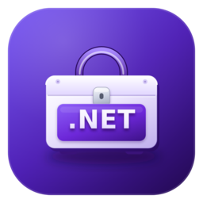

<h1 align="center">🧰 Dotnet Pro Pack</h1>

  

  
  

  <b>English</b> | <a href="https://github.com/dimanrus/dotnet-pro-pack-vscode/blob/main/README.ru.md">Русский</a>

**Dotnet Pro Pack** is an extension pack for Visual Studio Code that brings together everything
you need for professional .NET development: C#, F#, MAUI, Avalonia, Uno Platform, OpenSilver,
Unity, MonoGame, Tizen, .NET nanoFramework, .NET Aspire, containers, databases and APIs,
GitHub workflows, remote development, AI assistants, diagrams, and productivity tools.

> One click gives you a complete, consistent .NET development environment in VS Code —
> no need to find and install dozens of extensions by hand.

> ℹ️ **You don't have to install the whole pack.** Not everyone builds games or a particular
> type of app, so every extension in the tables below can also be installed on its own — just
> click **Install** on the one you like.

## 🧩 What's inside

### 💜 .NET, C# and F#

| Extension | Description |
| --- | --- |
| [C#](https://marketplace.visualstudio.com/items?itemName=ms-dotnettools.csharp) | C# language support: IntelliSense, debugging, refactoring, navigation |
| [C# Dev Kit](https://marketplace.visualstudio.com/items?itemName=ms-dotnettools.csdevkit) | Solutions, projects, testing, and running .NET applications |
| [Ionide for F#](https://marketplace.visualstudio.com/items?itemName=Ionide.Ionide-fsharp) | F# language support: IntelliSense, tooltips, error highlighting, refactoring |

### 🤖 AI assistants

| Extension | Description |
| --- | --- |
| [DeepSeek V4 for Copilot](https://marketplace.visualstudio.com/items?itemName=Vizards.deepseek-v4-for-copilot) | DeepSeek V4 models for GitHub Copilot Chat |

### 🎨 Cross-platform app development and UI

| Extension | Description |
| --- | --- |
| [.NET MAUI](https://marketplace.visualstudio.com/items?itemName=ms-dotnettools.dotnet-maui) | .NET MAUI support: XAML, Hot Reload, debugging |
| [MAUI Archive](https://marketplace.visualstudio.com/items?itemName=banditoth.VSCode-MAUI-Archive) | Working with MAUI project archives and templates |
| [Avalonia](https://marketplace.visualstudio.com/items?itemName=AvaloniaTeam.vscode-avalonia) | Avalonia UI and XAML support |
| [Uno Platform](https://marketplace.visualstudio.com/items?itemName=unoplatform.vscode) | Build applications with Uno Platform |
| [OpenSilver](https://marketplace.visualstudio.com/items?itemName=userware.vscode-opensilver) | OpenSilver development (WPF/XAML for WebAssembly) |
| [Caspian Emulator](https://marketplace.visualstudio.com/items?itemName=CaspianTools.caspian-emulator) | Mobile device emulation for development |
| [Tizen C#](https://marketplace.visualstudio.com/items?itemName=tizen.vscode-tizen-csharp) | C# development for the Tizen platform |
| [Tizen Profiler](https://marketplace.visualstudio.com/items?itemName=TizenProfiler.tmp-vscode-ext) | Profiling Tizen applications |
| [nanoFramework](https://marketplace.visualstudio.com/items?itemName=nanoframework.vscode-nanoframework) | .NET nanoFramework development for microcontrollers |

### 🎮 Game development

| Extension | Description |
| --- | --- |
| [Unity](https://marketplace.visualstudio.com/items?itemName=VisualStudioToolsForUnity.vstuc) | Visual Studio Tools for Unity: debugging and Unity API integration |
| [MonoGame](https://marketplace.visualstudio.com/items?itemName=r88.monogame) | Support for the MonoGame game framework |

### ☁️ Cloud, containers, and collaboration

| Extension | Description |
| --- | --- |
| [.NET Aspire](https://marketplace.visualstudio.com/items?itemName=microsoft-aspire.aspire-vscode) | .NET Aspire support: orchestration, dashboard, services |
| [Container Tools](https://marketplace.visualstudio.com/items?itemName=ms-azuretools.vscode-containers) | Containers and Dev Containers |
| [Live Share](https://marketplace.visualstudio.com/items?itemName=MS-vsliveshare.vsliveshare) | Real-time collaborative editing and debugging |
| [NuGet Workbench](https://marketplace.visualstudio.com/items?itemName=nuget-workbench.nuget-workbench) | NuGet package management |

### 🔀 Git and GitHub

| Extension | Description |
| --- | --- |
| [GitHub Actions](https://marketplace.visualstudio.com/items?itemName=GitHub.vscode-github-actions) | Manage GitHub Actions workflows and runs |
| [GitHub Pull Requests](https://marketplace.visualstudio.com/items?itemName=GitHub.vscode-pull-request-github) | Review and manage pull requests and issues on GitHub |

### 🌐 Remote development

| Extension | Description |
| --- | --- |
| [Remote - SSH](https://marketplace.visualstudio.com/items?itemName=ms-vscode-remote.remote-ssh) | Open any folder on a remote machine over SSH |
| [Remote Explorer](https://marketplace.visualstudio.com/items?itemName=ms-vscode.remote-explorer) | View and manage SSH and remote targets |

### 🗄️ Data, APIs, and utilities

| Extension | Description |
| --- | --- |
| [DBCode](https://marketplace.visualstudio.com/items?itemName=DBCode.dbcode) | Work with databases right inside the editor |
| [Redis Client](https://marketplace.visualstudio.com/items?itemName=cweijan.vscode-redis-client) | Redis client |
| [Postman for VS Code](https://marketplace.visualstudio.com/items?itemName=Postman.postman-for-vscode) | HTTP API testing and debugging |
| [Rainbow CSV](https://marketplace.visualstudio.com/items?itemName=mechatroner.rainbow-csv) | CSV/TSV highlighting and tooling |
| [Data Wrangler](https://marketplace.visualstudio.com/items?itemName=ms-toolsai.datawrangler) | Explore, transform, and analyze tabular data |
| [Hex Editor](https://marketplace.visualstudio.com/items?itemName=ms-vscode.hexeditor) | Hex editing for binary files |
| [Speedscope](https://marketplace.visualstudio.com/items?itemName=sransara.speedscope-in-vscode) | Performance profile visualization |
| [SandDance](https://marketplace.visualstudio.com/items?itemName=msrvida.vscode-sanddance) | Data visualization and exploration |

### ⚡ Productivity

| Extension | Description |
| --- | --- |
| [Better Todo Tree](https://marketplace.visualstudio.com/items?itemName=FanaticPythoner.better-todo-tree) | Collect TODO, FIXME, and other tags in a tree view |
| [CodeSnap](https://marketplace.visualstudio.com/items?itemName=adpyke.codesnap) | Take beautiful screenshots of your code |

### 📊 Diagrams and visual modeling

| Extension | Description |
| --- | --- |
| [Draw.io Integration](https://marketplace.visualstudio.com/items?itemName=hediet.vscode-drawio) | draw.io diagrams right in VS Code |
| [Figma for VS Code](https://marketplace.visualstudio.com/items?itemName=figma.figma-vscode-extension) | View Figma designs and work with design assets |
| [Excalidraw](https://marketplace.visualstudio.com/items?itemName=pomdtr.excalidraw-editor) | Sketch diagrams in the Excalidraw format |

### 🛠️ dimanrus tools

| Extension | Description |
| --- | --- |
| [Dev Tools Toolbox](https://marketplace.visualstudio.com/items?itemName=dimanrus.dev-tools-vscode) | A set of developer tools |
| [Monitor Dotnet](https://marketplace.visualstudio.com/items?itemName=dimanrus.monitor-dotnet) | .NET application monitoring |
| [Exploring Collections](https://marketplace.visualstudio.com/items?itemName=dimanrus.exploring-collections) | Exploring .NET collections |
| [ILASM Dotnet](https://marketplace.visualstudio.com/items?itemName=dimanrus.ilasm-dotnet) | IL Assembly language support |

## ✅ Requirements

- Visual Studio Code **1.105.0** or newer.
- Some extensions may require the [.NET SDK](https://dotnet.microsoft.com/download) and
  the corresponding workloads (for example, `.NET MAUI`).
- Individual extensions (Tizen, nanoFramework, Caspian Emulator) may have their own
  system requirements — see their documentation.