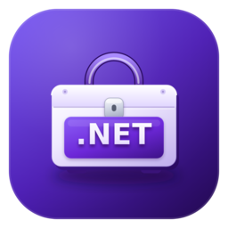

<h1 align="center">🧰 Dotnet Pro Pack</h1>

  

  
  

  <a href="https://github.com/dimanrus/dotnet-pro-pack-vscode/blob/main/README.md">English</a> | <b>Русский</b>

**Dotnet Pro Pack** — это набор расширений (extension pack) для Visual Studio Code, который
собирает в одном месте всё необходимое для профессиональной .NET-разработки: C#, F#, MAUI,
Avalonia, Uno Platform, OpenSilver, Unity, MonoGame, Tizen, .NET nanoFramework, .NET Aspire,
контейнеры, работу с базами данных и API, GitHub workflow, удалённую разработку, AI-ассистентов,
диаграммы и инструменты продуктивности.

> Одним кликом вы получаете готовую, согласованную среду для разработки .NET-приложений
> в VS Code — без ручного поиска и установки десятков расширений.

> ℹ️ **Не обязательно устанавливать весь набор.** Не все делают игры или какой-то
> определённый тип приложений, поэтому любое расширение из таблиц ниже можно установить
> отдельно — достаточно нажать **Install** на том, которое вам понравилось.

## 🧩 Что входит в набор

### 💜 .NET, C# и F#

| Расширение | Описание |
| --- | --- |
| [C#](https://marketplace.visualstudio.com/items?itemName=ms-dotnettools.csharp) | Поддержка языка C#: IntelliSense, отладка, рефакторинг, навигация |
| [C# Dev Kit](https://marketplace.visualstudio.com/items?itemName=ms-dotnettools.csdevkit) | Решения, проекты, тестирование и запуск приложений .NET |
| [Ionide для F#](https://marketplace.visualstudio.com/items?itemName=Ionide.Ionide-fsharp) | Поддержка языка F#: IntelliSense, подсказки, подсветка ошибок, рефакторинг |

### 🤖 AI-ассистенты

| Расширение | Описание |
| --- | --- |
| [DeepSeek V4 for Copilot](https://marketplace.visualstudio.com/items?itemName=Vizards.deepseek-v4-for-copilot) | Модели DeepSeek V4 для GitHub Copilot Chat |

### 🎨 Кроссплатформенная разработка и UI

| Расширение | Описание |
| --- | --- |
| [.NET MAUI](https://marketplace.visualstudio.com/items?itemName=ms-dotnettools.dotnet-maui) | Поддержка .NET MAUI: XAML, Hot Reload, отладка |
| [MAUI Archive](https://marketplace.visualstudio.com/items?itemName=banditoth.VSCode-MAUI-Archive) | Работа с архивами и шаблонами проектов MAUI |
| [Avalonia](https://marketplace.visualstudio.com/items?itemName=AvaloniaTeam.vscode-avalonia) | Поддержка Avalonia UI и XAML |
| [Uno Platform](https://marketplace.visualstudio.com/items?itemName=unoplatform.vscode) | Разработка приложений на Uno Platform |
| [OpenSilver](https://marketplace.visualstudio.com/items?itemName=userware.vscode-opensilver) | Разработка на OpenSilver (WPF/XAML для WebAssembly) |
| [Caspian Emulator](https://marketplace.visualstudio.com/items?itemName=CaspianTools.caspian-emulator) | Эмуляция мобильных устройств для разработки |
| [Tizen C#](https://marketplace.visualstudio.com/items?itemName=tizen.vscode-tizen-csharp) | Разработка на C# для платформы Tizen |
| [Tizen Profiler](https://marketplace.visualstudio.com/items?itemName=TizenProfiler.tmp-vscode-ext) | Профилирование Tizen-приложений |
| [nanoFramework](https://marketplace.visualstudio.com/items?itemName=nanoframework.vscode-nanoframework) | Разработка на .NET nanoFramework для микроконтроллеров |

### 🎮 Разработка игр

| Расширение | Описание |
| --- | --- |
| [Unity](https://marketplace.visualstudio.com/items?itemName=VisualStudioToolsForUnity.vstuc) | Visual Studio Tools for Unity: отладка и интеграция с Unity API |
| [MonoGame](https://marketplace.visualstudio.com/items?itemName=r88.monogame) | Поддержка игрового фреймворка MonoGame |

### ☁️ Облако, контейнеры и совместная работа

| Расширение | Описание |
| --- | --- |
| [.NET Aspire](https://marketplace.visualstudio.com/items?itemName=microsoft-aspire.aspire-vscode) | Поддержка .NET Aspire: оркестрация, дашборд, сервисы |
| [Container Tools](https://marketplace.visualstudio.com/items?itemName=ms-azuretools.vscode-containers) | Работа с контейнерами и Dev Containers |
| [Live Share](https://marketplace.visualstudio.com/items?itemName=MS-vsliveshare.vsliveshare) | Совместное редактирование и отладка в реальном времени |
| [NuGet Workbench](https://marketplace.visualstudio.com/items?itemName=nuget-workbench.nuget-workbench) | Управление пакетами NuGet |

### 🔀 Git и GitHub

| Расширение | Описание |
| --- | --- |
| [GitHub Actions](https://marketplace.visualstudio.com/items?itemName=GitHub.vscode-github-actions) | Управление workflow и запусками GitHub Actions |
| [GitHub Pull Requests](https://marketplace.visualstudio.com/items?itemName=GitHub.vscode-pull-request-github) | Работа с pull request'ами и issue на GitHub |

### 🌐 Удалённая разработка

| Расширение | Описание |
| --- | --- |
| [Remote - SSH](https://marketplace.visualstudio.com/items?itemName=ms-vscode-remote.remote-ssh) | Открытие папок на удалённой машине по SSH |
| [Remote Explorer](https://marketplace.visualstudio.com/items?itemName=ms-vscode.remote-explorer) | Просмотр и управление SSH- и удалёнными целями |

### 🗄️ Данные, API и утилиты

| Расширение | Описание |
| --- | --- |
| [DBCode](https://marketplace.visualstudio.com/items?itemName=DBCode.dbcode) | Работа с базами данных прямо в редакторе |
| [Redis Client](https://marketplace.visualstudio.com/items?itemName=cweijan.vscode-redis-client) | Клиент Redis |
| [Postman for VS Code](https://marketplace.visualstudio.com/items?itemName=Postman.postman-for-vscode) | Тестирование и отладка HTTP API |
| [Rainbow CSV](https://marketplace.visualstudio.com/items?itemName=mechatroner.rainbow-csv) | Подсветка и работа с CSV/TSV |
| [Data Wrangler](https://marketplace.visualstudio.com/items?itemName=ms-toolsai.datawrangler) | Исследование, преобразование и анализ табличных данных |
| [Hex Editor](https://marketplace.visualstudio.com/items?itemName=ms-vscode.hexeditor) | Редактирование бинарных файлов в hex-режиме |
| [Speedscope](https://marketplace.visualstudio.com/items?itemName=sransara.speedscope-in-vscode) | Визуализация профилей производительности |
| [SandDance](https://marketplace.visualstudio.com/items?itemName=msrvida.vscode-sanddance) | Визуализация и исследование данных |

### ⚡ Продуктивность

| Расширение | Описание |
| --- | --- |
| [Better Todo Tree](https://marketplace.visualstudio.com/items?itemName=FanaticPythoner.better-todo-tree) | Сбор TODO, FIXME и других меток в дереве |
| [CodeSnap](https://marketplace.visualstudio.com/items?itemName=adpyke.codesnap) | Красивые скриншоты фрагментов кода |

### 📊 Диаграммы и визуальное моделирование

| Расширение | Описание |
| --- | --- |
| [Draw.io Integration](https://marketplace.visualstudio.com/items?itemName=hediet.vscode-drawio) | Диаграммы draw.io прямо в VS Code |
| [Figma for VS Code](https://marketplace.visualstudio.com/items?itemName=figma.figma-vscode-extension) | Просмотр макетов Figma и работа с дизайном |
| [Excalidraw](https://marketplace.visualstudio.com/items?itemName=pomdtr.excalidraw-editor) | Рисование схем и скетчей в формате Excalidraw |

### 🛠️ Инструменты dimanrus

| Расширение | Описание |
| --- | --- |
| [Dev Tools Toolbox](https://marketplace.visualstudio.com/items?itemName=dimanrus.dev-tools-vscode) | Набор инструментов разработчика |
| [Monitor Dotnet](https://marketplace.visualstudio.com/items?itemName=dimanrus.monitor-dotnet) | Мониторинг .NET-приложений |
| [Exploring Collections](https://marketplace.visualstudio.com/items?itemName=dimanrus.exploring-collections) | Исследование коллекций .NET |
| [ILASM Dotnet](https://marketplace.visualstudio.com/items?itemName=dimanrus.ilasm-dotnet) | Поддержка языка IL Assembly |

## ✅ Требования

- Visual Studio Code **1.105.0** или новее.
- Некоторые расширения могут требовать установленный [.NET SDK](https://dotnet.microsoft.com/download)
  и соответствующие workload-и (например, `.NET MAUI`).
- Отдельные расширения (Tizen, nanoFramework, Caspian Emulator) могут иметь собственные
  системные требования — см. их документацию.